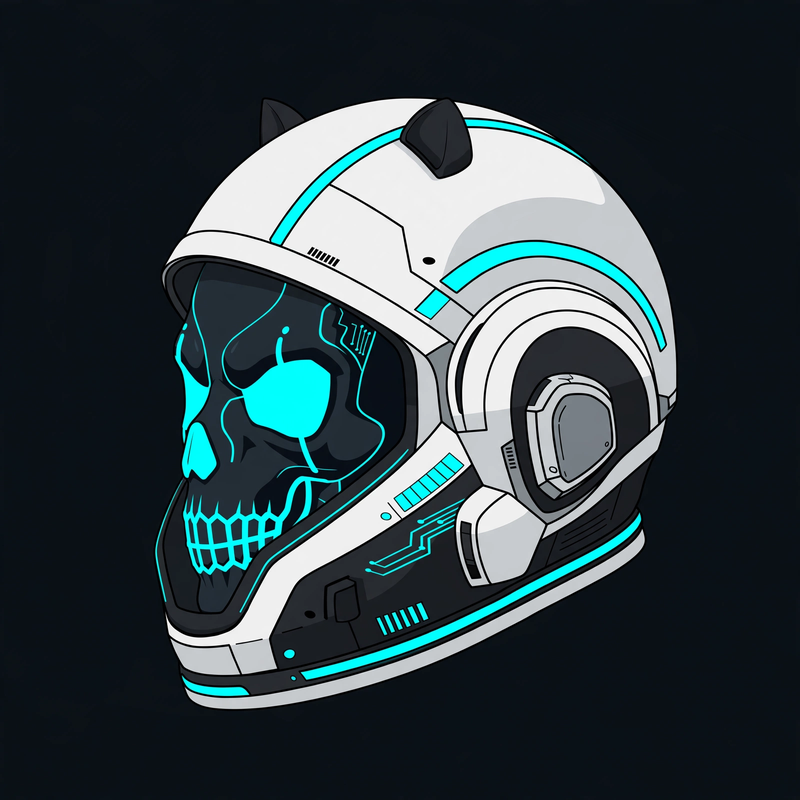

<div align="center">

<br><br>

<a href="https://meowlabs.id/"></a>
<a href="https://ai.meowlabs.id/"></a>
<a href="mailto:hasrinata@gmail.com"></a>

</div>

<br>

<a>

</a>

```rust
pub const ARYA: Dev = Dev {
    name: "Hasrinata Arya Afendi",
    username: "Urdemonlord",
    role: "Founder, Meow Labs",
    company: "Meow Labs 🐾",
    city: "Indonesia, 🇮🇩 (UTC+07:00)",
    lang: &["id", "en"],
    focus: &[
        "AI-native products",
        "AI Security",
        "Self-hosted systems",
        "Indonesian language AI",
    ],
    currently_on: &[
        "IRIS v0.4.1",
        "Laras",
        "Kirana",
    ],
};
```

> "I build useful, production-ready systems, and turn them into real products."

## Flagship Products

**IRIS**, self-hosted webmail in Rust, open source. **Laras**, Indonesian voice cloning, CPU-only. **Kirana**, CPNS SKD tryout. **Aksaria**, JLPT learning. **GenCV**, AI CV and job hunter. **AI App Builder**, prompt to production app. **[See all projects →](PROJECTS.md)**

<br>

## Open Source Contributions

IRIS, Laras, and Getman docs and fixes, plus prompt-injection research with DeBERTa-v3-base. **[See all contributions →](CONTRIBUTIONS.md)**

<br>

## Tech Stack

Rust, TypeScript, Next.js, Astro, Python, Docker, Linux, PostgreSQL and SQLite. **[See the full tech stack →](TECH_STACK.md)**

<br>

<div align="center">

<sub>Building AI-native products at <a href="https://meowlabs.id/">Meow Labs</a></sub> 🐾

</div>
